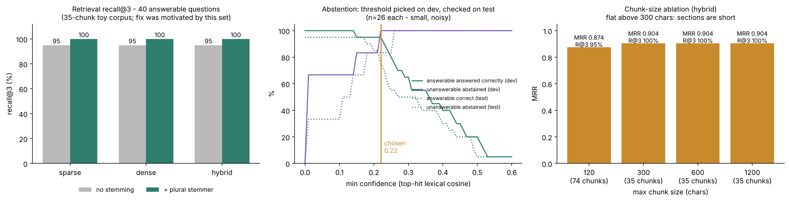

# Enterprise Knowledge RAG on a Vector Engine
**Retrieval-augmented Q&A with citations, calibrated abstention, an evaluation harness and a HANA Cloud vector-store adapter.**
Built as a portfolio project for an *AI Factory Associate Consultant* profile (RAG pipelines on SAP BTP / HANA Cloud vector engine).



## What it does
Ingests markdown policy documents, answers questions with `[document > section]` citations, and **refuses to answer when the evidence is weak** instead of guessing.

```
Q: At what value do I need three competitive quotes?
A: Three competitive quotes are required for any purchase above EUR 25,000. [procurement_policy > Competitive quotes]

Q: What is the current share price?
A: I don't know based on the provided documents.
```

## Measured results (reproducible: `make test eval report`)
Toy-scale benchmark: **12 documents -> 35 chunks**, **52 questions** (40 answerable with gold evidence, 12 unanswerable).

| | sparse | dense (LSA) | hybrid (RRF) |
|---|---|---|---|
| recall@1 | 82.5% | 82.5% | 82.5% |
| recall@3 | 100.0% | 100.0% | 100.0% |
| MRR | 0.908 | 0.904 | 0.904 |

- **Eval-driven fix:** two questions initially missed the top 10 entirely (*receipt* vs *receipts*, *accrual* vs *accruals*). Adding a small plural-unifying stemmer moved hybrid recall@3 from **95.0% to 100.0%** (MRR 0.879 -> 0.904). The fix was motivated by this same question set, so treat that gain as **in-sample**.
- **Abstention** (threshold **0.22** calibrated on a dev split, reported on a held-out test split of 26 questions): dev balanced accuracy **97.5%**, test **79.2%** - test: 83.3% of unanswerable questions correctly refused, 20.0% of answerable ones wrongly refused. With ~6 unanswerable questions per split these rates are noisy; the dev->test drop is expected, not a bug.
- **Vector stores:** FAISS and NumPy return the same top-1 on **52/52** questions.
- **Chunk size:** 74 chunks at 120 chars scores worse (recall@3 95.0%); 300+ chars gives identical chunks because every section here is already short.
- **Latency:** mean 1.53 ms per question (p95 1.92 ms; varies run to run) - on 35 chunks, exhaustive scoring, this laptop-class container. Says nothing about large corpora.
- **25 automated tests**, including a gold-evidence integrity test and a property test that every extractive answer sentence appears verbatim in a retrieved chunk.

### Read this before quoting the numbers
- Embeddings are a **local LSA stand-in**, not a hosted embedding model. At 35 chunks dense/hybrid do not beat sparse - that is reported, not hidden.
- The generator is **extractive** (no hallucination, but no reasoning or paraphrase). `LLMGenerator` has a grounded-answer prompt that is unit-tested for construction only; **no live LLM was run**.
- `HanaVectorStore` is **unit-tested for SQL generation with a fake connection only** - it has never run against a real HANA Cloud instance (see [`docs/hana_vector_engine.md`](docs/hana_vector_engine.md)). Nothing here was deployed to SAP BTP.

## Layout
```
corpus/   12 synthetic policy documents (fictional company; consistent, no real policies)
rag/      chunking, embeddings (+stemmer), vectorstore (NumPy | FAISS | HANA adapter), retriever, generator, pipeline, calibration.json
evals/    qa_set.jsonl (52 Q), run_evals.py, results.json
app/      FastAPI wrapper (/ask, /health)
tests/    25 tests
docs/     architecture.md, functional_spec.md, hana_vector_engine.md, eval_report.md, img/
```

## Quickstart
```bash
pip install -r requirements.txt
make test eval charts report
python -c "from rag.pipeline import RagPipeline as P; print(P.build().ask('How long are blanket purchase orders valid?').text)"
uvicorn app.api:api          # POST /ask {"question": "..."}
```

## JD alignment
| JD line | Where |
|---|---|
| Build and test RAG pipelines | `rag/`, `tests/`, `evals/` |
| SAP HANA Cloud vector engine | `HanaVectorStore` adapter (SQL-tested; real-instance run still to do) |
| Write tests, run evaluations, CI/CD | pytest suite + GitHub Actions eval gate (`.github/workflows/ci.yml`) |
| Prepare specifications for customer implementations | `docs/functional_spec.md` |

## Resume bullets (accurate as built)
- Built an enterprise RAG pipeline (heading-aware chunking, sparse/dense/hybrid retrieval, citations, calibrated abstention) over a 12-document synthetic policy corpus, with a vector-store abstraction covering NumPy, FAISS and a HANA Cloud adapter.
- Designed a 52-question evaluation harness; diagnosed two retrieval misses as plural-morphology gaps and fixed them with a stemmer (hybrid recall@3 95.0% -> 100.0%, in-sample); calibrated abstention on a dev split and reported it on a held-out test split.
- Shipped 25 tests and a CI eval gate (retrieval, store parity, abstention regression).
